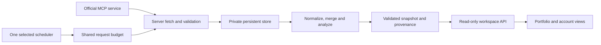

# Account Brief · Questathon CRM

**Understand an account, inspect the evidence, and choose the next conversation.**

Account Brief turns scattered account records into a practical handover: commercial context, stakeholder authority, three ranked next actions, risks, and open questions. It was built for the Questathon software round. The app reads the official MCP service, stores what it fetches, and updates its analysis as new signals arrive.

**[Open the deployed app](https://questathon-crm-blue.vercel.app)** · [Thinking behind the build](docs/THINKING.md) · [Three-minute walkthrough](docs/WALKTHROUGH.md)

## What you can do

| View | What it helps you understand |
| --- | --- |
| Portfolio | Compare accounts, search the workspace, filter an opportunity-stage chart, and find each account’s first proposed conversation. |
| Account overview | Separate existing annual contract value, opportunity value and newly booked value; inspect ranked actions, incoming signals, risks and unknowns. |
| Visuals | Explore weekly flight activity with device coverage and source links; inspect the recorded opportunity stages. Missing weeks are not plotted as zero. |
| Deals | Review each opportunity’s stage, value, blockers, deadline and evidence. Account-level offers keep their own status. |
| People | Distinguish decision authority, budget, operations and dependencies, including what still needs confirmation. |
| Evidence | Search supporting records and open source drawers from individual facts, actions and chart points. |
| Connection status | See the last successful signal check, completed ingestion step, pending work and cache timestamp. |

The interface reveals supporting detail on demand. It does not present every source document on the overview.

## Run locally

Requires **Node.js 22.9 or later** and npm.

```sh
git clone https://github.com/rajrasane/questathon-crm.git
cd questathon-crm
npm ci
npm run setup
```

The setup command creates a Git-ignored `.env.local` with owner-only permissions and never overwrites an existing file. Set its values in your editor:

```dotenv
AQ_TOKEN=your-token-here
CRM_INGESTION_OWNER=this-process
CRM_DATA_DIR=.private
PORT=3000
```

**Production currently owns MCP ingestion.** To enable a laptop caller with the same token, first disable the hosted scheduler/owner, finish any in-flight request, and wait at least 61 seconds. Local and hosted storage do not share a rate-limit coordinator; never enable both callers.

```sh
npm run dev
```

Open **http://localhost:3000**. The server fetches records through MCP; there is no JSON download or manual-import step. Initial loading takes several minutes because requests are serialized. Partial validated records appear while supporting files load.

For UI work without upstream calls, leave `AQ_TOKEN` empty or run with ownership disabled:

```sh
CRM_INGESTION_OWNER=disabled npm run dev
```

An existing local cache remains viewable. A fresh clone correctly shows an unconfigured state; no private account data or fabricated customer fixtures are bundled.

## How the data moves



1. Fetch the initial account export, bulk paperwork and referenced files once, then reuse the stored baseline.
2. Discover released accounts through `whoami`, then fetch their packs and files with the released-account tools. There is no fixed two-account limit.
3. Check `get_signals`; merge events by account and stable signal ID, usage by device/week, and requests by their row keys.
4. Recompute the brief when content changes. Repeated identical inputs preserve the snapshot and do not duplicate event history.
5. Validate source references before publishing. A failed request or invalid response retains the last validated snapshot.

The transport supports JSON and SSE responses and decodes MCP text content before validating tool results. Browser refreshes call only `/api/workspace`; they do **not** make MCP requests. The browser also refreshes the stored workspace every 15 seconds.

| Runtime | Persistence and cadence |
| --- | --- |
| Local Node server | Ignored `.private/` directory, or `CRM_DATA_DIR`. A 65-second startup delay and ingestion cycle; each attempted request reserves a persistent 61-second budget. Restarts resume missing fetches. |
| Vercel production | Private Upstash Redis store and one protected QStash invocation every two minutes. Atomic Redis lease/cooldown coordinates function instances. Each invocation makes at most one upstream call. |

Baseline loading takes priority over signal checks. After loading, released-account discovery runs on the next available cycle when its ten-minute interval is due. Failures also consume the upstream request budget. Vercel has no persistent background timer; the external scheduler invokes it.

## What the analysis means

Analysis is deterministic and rule-based. AI assisted the implementation; runtime recommendations do not require an LLM service.

- **Evidence stays attached.** Facts, identities, amounts, deadlines and chart points link to supporting records. Claims, told/reported statements, verified evidence and interpretations remain distinguishable.
- **Money stays honest.** Existing contracts, potential opportunities, projections and newly booked value remain separate. Unknown amounts are not zero, currencies are not invented, and an accepted offer is not automatically recognized revenue.
- **Authority requires evidence.** A title, past signature or friendly contact does not prove current purchasing or budget authority.
- **Actions are proposals.** Owners and dates are suggested follow-ups, with a reason and intended outcome. They are not customer commitments or completed tasks.
- **Disagreement is visible.** Supported contradictions remain side by side. Unknowns include a way to resolve them.
- **Time has context.** Scenario dates, upstream retrieval times and local cache timestamps are separate. Rebuilding a cache does not imply a fresh upstream fetch.

See [analysis rules and their limits](docs/ANALYSIS.md) and the [data contract](docs/DATA_CONTRACT.md).

## Read the status correctly

“Evidence gaps” describes the account’s unresolved information. It is separate from connection health.

- **Connected:** a recent signal check succeeded.
- **Loading supporting records:** baseline work remains, or no successful signal check has yet been recorded.
- **Check overdue / needs attention:** a check is old or failed; inspect the saved timestamp and pending work.
- **Cached workspace:** live ingestion is disabled for this runtime.

For local diagnostics:

```sh
npm run live:status
```

A saved success timestamp is a record of a completed check, not proof that a local server process is still running. The optional `npm run live` launcher can accept hidden terminal token entry, but `.env.local` avoids entering it repeatedly.

## Deploy and operate

The deployed app uses `main`, Vercel, private Redis persistence and a protected QStash trigger. Build with `npm run build`; Vite outputs `dist`. Vercel serves the Node handlers in `api/`.

Set production-only server configuration: `AQ_TOKEN`, `CRM_INGESTION_OWNER=hosted`, `UPSTASH_REDIS_REST_URL`, `UPSTASH_REDIS_REST_TOKEN`, and `CRON_SECRET`. Keep ingestion disabled in preview deployments. The scheduler sends its credential in the Authorization header, never in a URL.

Follow [hosted setup and handover](docs/HOSTED_SETUP.md) for coordination, ownership, persistence and acceptance checks. The current setup uses free provider plans with scheduler retries disabled and Redis automatic upgrades disabled; provider quotas still need monitoring.

For a persistent Node host, after building:

```sh
NODE_ENV=production npm start
```

Keep one shared coordinator directory for local processes using the same token. Different hosts require shared coordination. Crash-leftover local locks fail closed and require operator review.

## Development and verification

```sh
npm run lint
npm run typecheck
npm run build
npm test
```

Build before testing so the browser-bundle exclusion check examines current assets. Tests use isolated synthetic fixtures and mocked MCP responses. They cover provenance, unknown values, real transport envelopes, released-account discovery, restart/resume, concurrency, failed-call cooldowns, idempotent updates, chart row merging and private HTTP boundaries. Mocked changed-signal tests are distinct from observing a new event on the live service.

| Directory | Responsibility |
| --- | --- |
| `src/` | React views, evidence drawers, charts and presentation schema |
| `server/` | MCP adapters, persistent coordination, normalization, analysis and HTTP server |
| `api/` | Vercel workspace and protected ingestion handlers |
| `scripts/` | Local setup, launcher and status commands |
| `tests/` | Synthetic unit and integration tests |
| `docs/` | Design thinking, analysis rules, deployment and walkthrough |

## Scope and boundaries

This is a read-only decision-support prototype, not a full multi-user sales system. It does not play the game, automatically write notes, send messages, close deals, or execute proposed actions. Its rules recognize supported patterns rather than exhaustively interpreting every document.

The judging app exposes its normalized fictional account evidence to viewers. A real customer deployment would require authentication, authorization and a data-sharing policy. Raw caches, credentials and private research never belong in this repository. `.env.local` and `.private/` are ignored and denied by the local file server; browser bundles contain no upstream token. The ingestion endpoint rejects unauthorized calls.

Final event submission and the review of presentation materials remain the owner’s decision.
